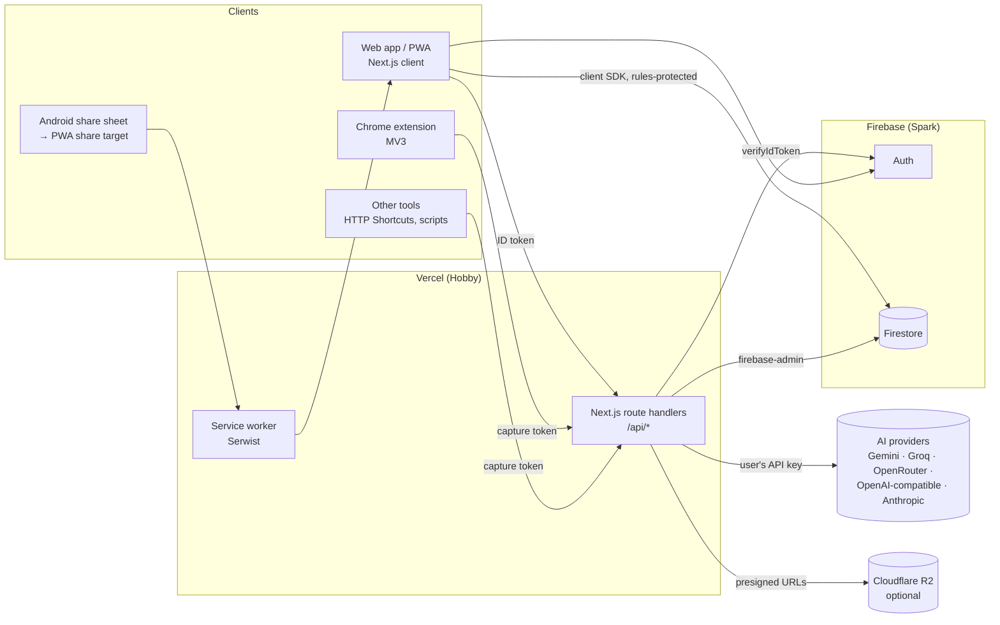

# 01 — Architecture

## 1. Overview



**Two data paths:**

1. **Direct client path** (web/PWA): the signed-in browser reads/writes the owner's data
   directly in Firestore through the JS SDK; security rules enforce ownership and shape.
   Firestore persistent cache gives offline reads and queued writes.
2. **Server path** (`/api/*` on Vercel): anything needing a secret or the network —
   URL unfurling, AI calls (decrypting the user's key), capture token auth for the
   extension, R2 presigning, import processing. Uses `firebase-admin`.

There are **no Cloud Functions** (Spark plan). No background workers: long jobs (bulk AI
classification of imports) run as client-driven batches calling `/api/ai/*` with
rate-limit awareness.

## 2. Free-tier budget (verify current limits before launch)

| Service | Plan | Relevant limits (approx.) | Design response |
|---|---|---|---|
| Firestore | Spark | ~1 GiB stored; ~50k reads, 20k writes, 20k deletes per day | Persistent local cache; delta sync by `updatedAt`; client-side search index; thumbnails small and optional |
| Firebase Auth | Spark | Free for email/Google sign-in | Google + email/password |
| Cloud Storage for Firebase | **Requires Blaze** (since the Sept 2024 change) | Not used | R2 adapter or no-binaries mode |
| Cloud Functions | **Requires Blaze** | Not used | Next.js route handlers |
| Vercel | Hobby (non-commercial) | Function duration and invocation limits | Keep routes short (< 10 s); AI calls with timeouts; no long jobs |
| Gemini API | Free tier | Small per-day quotas per project; free-tier data may be used to improve Google products | Pluggable providers; privacy flags; usage counters |
| Groq / OpenRouter free models | Free tier | Rate limits per minute/day | Same |
| Cloudflare R2 | Free tier (~10 GB) | May require a payment method on the Cloudflare account | Optional; default off |

## 3. Components

### 3.1 `apps/web` (Next.js, App Router)

```
apps/web/
├─ app/
│  ├─ (auth)/signin/page.tsx
│  ├─ (app)/layout.tsx              # shell: sidebar (desktop), bottom nav (mobile), Cmd-K
│  ├─ (app)/page.tsx                # Home
│  ├─ (app)/inbox/page.tsx
│  ├─ (app)/library/page.tsx
│  ├─ (app)/item/[id]/page.tsx
│  ├─ (app)/projects/page.tsx
│  ├─ (app)/projects/[id]/page.tsx
│  ├─ (app)/tasks/page.tsx
│  ├─ (app)/accounts/page.tsx
│  ├─ (app)/assistant/page.tsx
│  ├─ (app)/import/page.tsx
│  ├─ (app)/settings/[section]/page.tsx
│  ├─ (app)/trash/page.tsx
│  ├─ share/page.tsx                # PWA share-target landing (client)
│  ├─ api/…                         # see 03-API.md
│  ├─ manifest.ts                   # web app manifest incl. share_target
│  └─ sw.ts                         # Serwist service worker source
├─ components/ (ui/ from shadcn, item/, inbox/, capture/, …)
├─ lib/
│  ├─ firebase/client.ts            # initializeApp, auth, firestore w/ persistentLocalCache
│  ├─ firebase/admin.ts             # admin app (server only)
│  ├─ auth/verify.ts                # verifyIdToken + owner allow-list
│  ├─ auth/captureToken.ts          # hash + lookup
│  ├─ data/                         # typed repositories: items, projects, tasks, accounts…
│  ├─ sync/                         # delta sync + MiniSearch index
│  ├─ unfurl/                       # safe fetch + metadata parse
│  ├─ ai/                           # provider adapters, task runners, prompts
│  ├─ crypto/                       # AES-256-GCM for API keys
│  └─ storage/                      # StorageAdapter: none | r2
└─ tests/
```

### 3.2 `apps/extension` (Chrome MV3)

```
apps/extension/
├─ manifest.json
├─ src/background.ts     # service worker: context menus, commands, API calls, offline queue
├─ src/popup/            # Quick Save UI
├─ src/options/          # server URL, capture token, defaults
└─ src/lib/api.ts
```

### 3.3 `packages/shared`

Zod schemas and types for every entity and API payload; `normalizeUrl()`;
`detectPlatform()`; `applyRules()` (pure, used by web, server and extension preview);
`parseQuickAdd()` (URL vs text vs task syntax); constants (item kinds, platforms).

## 4. Key flows

**Capture (extension):** popup collects `{url,title,selection,favIconUrl}` from the active
tab → `POST /api/capture` with capture token → server normalises URL, de-duplicates
(`urlHash`), applies rules, writes item `status: "inbox"` → returns item id → background
optionally calls `/api/unfurl` and `/api/ai/suggest` (if auto-AI on) → item updated.

**Capture (Android):** share sheet → PWA share target `POST /share-target` intercepted by
the service worker → payload (title, text, url, files) stored in IndexedDB → redirect to
`/share` → page reads payload, shows a 1-screen confirm (area/tags/note, Save) → writes via
Firestore SDK (works offline) → triggers unfurl/AI when online.

**Organise:** on create, `applyRules()` sets area/tags/kind deterministically. If AI is
enabled for the item's area, `/api/ai/suggest` returns a suggestion object stored on the
item (`ai.suggestion`, `ai.status: "pending"`). Inbox shows suggestions as chips; accept
writes fields + `ai.status: "accepted"`.

**Search:** client keeps a MiniSearch index of the owner's non-deleted items/projects/
tasks/accounts (title, note, description, tags, domain, AI summary), persisted in
IndexedDB and updated from the delta-sync listener.

## 5. Environment variables

| Var | Where | Purpose |
|---|---|---|
| `NEXT_PUBLIC_FIREBASE_API_KEY`, `…_AUTH_DOMAIN`, `…_PROJECT_ID`, `…_APP_ID` | web (public) | Firebase client config (not secret) |
| `FIREBASE_ADMIN_PROJECT_ID`, `FIREBASE_ADMIN_CLIENT_EMAIL`, `FIREBASE_ADMIN_PRIVATE_KEY` | server | Service account for firebase-admin |
| `OWNER_EMAILS` | server | Comma-separated allow-list |
| `KEY_ENCRYPTION_SECRET` | server | 32-byte base64 key for AES-256-GCM of user AI keys |
| `KEY_ENCRYPTION_VERSION` | server | Integer for key rotation |
| `CAPTURE_TOKEN_PEPPER` | server | Secret mixed into capture-token hashes |
| `STORAGE_DRIVER` | server | `none` (default) or `r2` |
| `R2_ACCOUNT_ID`, `R2_ACCESS_KEY_ID`, `R2_SECRET_ACCESS_KEY`, `R2_BUCKET` | server | Only if `r2` |
| `APP_ORIGIN` | server | e.g. `https://personalhub-xyz.vercel.app`, used for CORS and links |
| `EXTENSION_IDS` | server | Allowed `chrome-extension://<id>` origins for CORS |

## 6. Architecture decisions (ADRs — copy into `docs/decisions/`)

**ADR-001 Firestore (Spark) as the only database.** Owner chose Firebase Auth + Firestore.
Document model fits items; offline cache is built in; free without card. Trade-offs: no
full-text search (→ client MiniSearch), no joins (→ denormalised fields), daily op quotas
(→ delta sync).

**ADR-002 No Cloud Functions; server logic in Next.js route handlers.** Functions need
Blaze. Route handlers on Vercel Hobby cover unfurl, AI, capture auth, presigning.

**ADR-003 PWA first, native later.** A PWA with Web Share Target appears in Android's share
sheet once installed from Chrome, needs no store account and shares the web codebase.
Limits: no background sync guarantees on all devices, share target only after install,
iOS does not support Web Share Target. Revisit (TWA via Bubblewrap, or Flutter) only if
these limits hurt in daily use.

**ADR-004 Binary storage optional (StorageAdapter).** Default `none`: images are
processed client-side (resize/compress), optionally sent to a vision model for
text/description, and only a small thumbnail (≤ 60 KB WebP, opt-in) is stored in
Firestore in a separate `blobs` doc. `r2` driver: private bucket, presigned PUT/GET from
`/api/storage/*`. Verify whether Cloudflare requires a payment method for R2 before
choosing it.

**ADR-005 AI provider abstraction with user keys.** One interface, adapters for Gemini,
Groq, OpenRouter, generic OpenAI-compatible (base URL), Anthropic. Per-task provider/model.
Keys encrypted server-side (AES-256-GCM), never returned to the client after save.

**ADR-006 Extension auth via personal capture tokens**, not Firebase Auth inside the
extension. Simpler and revocable; same token works for HTTP Shortcuts/scripts.

**ADR-007 Single-owner allow-list.** Rules and server both check the owner email; data is
still namespaced per uid for future multi-user.
